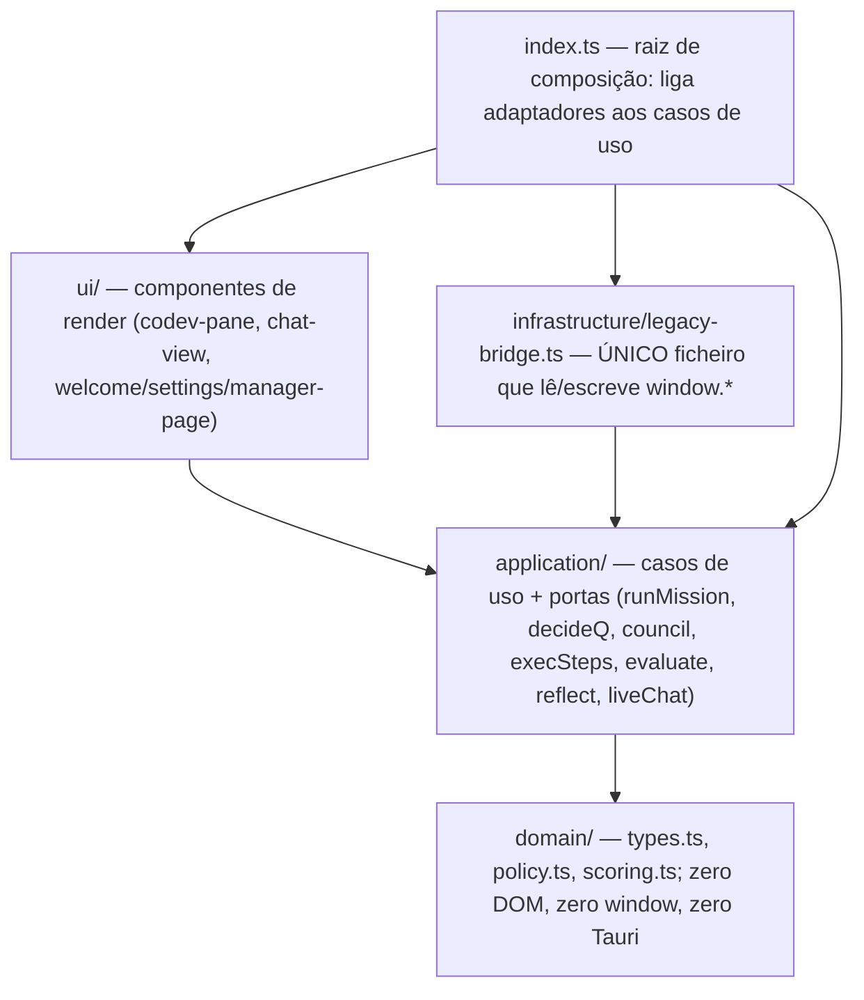

# ADR-0002 — Clean Architecture para a feature Co-Dev (`features/codev/`), piloto de extracção do monólito `ui-app`

- **Estado:** aceite (decisão de arquitectura); execução ainda não começou
- **Data:** 2026-11-19
- **Decisor:** responsável do projecto (angolardevops)
- **Contexto do commit:** `effcbd47720dc341ea463158118e6dc38fc3f52d` (branch `develop`)
- **Relacionado:** `ARCHITECTURE.md` §2–§3 (camadas-destino da UI, já esboçadas
  em alto nível: `app/`, `features/`, `shared/`); `MIGRATION.md` (campanha
  equivalente no backend Rust, Etapas 0–6); `ADR-0001` (qual é a UI oficial)
- **Nota:** esta ADR foi escrita a partir de dois contributos do dono no
  mesmo dia — o enunciado de execução (Fases 0–5) e, a seguir, uma análise
  mais fina com exemplos de código e o reforço do lado Rust/Tauri. Ambos
  ficam anexados verbatim no fim.

## Contexto

`ui-app/src/features/codev.ts` é uma feature-folha extraída do monólito
`app.ts` (ver histórico da reestruturação por funcionalidade em
`ARCHITECTURE.md` §3 e na memória de sessões anteriores). Hoje mistura, no
mesmo ficheiro e sob `// @ts-nocheck`:

- regras de domínio (política de aprovação por modo, limiar de avaliação,
  limite de tentativas de correcção);
- orquestração (`runMission`, `decideQ`, `council`, `execSteps`, `evaluate`,
  `reflect`, `liveChat`);
- infraestrutura (leituras/escritas directas em dezenas de globais `window.*`
  pertencentes a outros ficheiros — ficheiros, provedores, scm, equipa,
  checkpoints, helpers diversos); e
- apresentação (HTML interpolado directamente nas mesmas funções, com
  `onclick="..."` inline a resolver nomes livres no `window`).

O que cola estas quatro partes é o `window`, e é por isso que o ficheiro
precisa de `// @ts-nocheck`. Em concreto:

- **`window` como *service locator*:** `Object.assign(window,{...})` e
  leituras de globais livres (`MODE`, `RUN`, `PROV`, `FS`) escondem as
  dependências; nada é testável isoladamente.
- **Motor acoplado ao DOM:** `decideQ`, `council`, `execSteps` e
  `evaluate` decidem e desenham na mesma função — não se testa a regra
  «assistido pergunta abaixo de 80% de confiança» sem um browser.
- **Política de aprovação espalhada:** a regra vive dentro de `doTool`,
  repete-se em texto na tabela `POLICY` das Definições, e o limite «2
  tentativas» aparece em três sítios diferentes.
- **`onclick="..."` inline:** obriga a publicar tudo no `window` e abre
  injecção — `openPath('${p}')` e `${q.q}` entram sem `esc`, e
  `PROV.${k}.model=this.value` é código gerado por concatenação de string.
- **Conhecimento de cenário dentro do motor:** `S.id==='a'?'fix':'feature'`
  devia ser um campo do próprio cenário, não um `if` no motor.
- **Sete responsabilidades num ficheiro:** configuração, UI do chat,
  controlo de execução, ferramentas, cenários, motor, chat ao vivo, páginas
  e pane — tudo no mesmo módulo.

Esta sessão tentou uma primeira passagem de tipagem (remover `@ts-nocheck`,
encaminhar os globais por um novo `infrastructure/legacy-bridge.ts`) sem
antes acordar a forma-alvo. O resultado confirmou o diagnóstico: a tentativa
ficou presa em centenas de erros de tipo dispersos pelas quatro
responsabilidades acima, sem uma fronteira que isolasse o que é «regra»
do que é «ligação ao monólito» do que é «DOM». Esse trabalho fica
**parado, não commitado**, e será refeito depois desta decisão, já com o
caminho e as fronteiras aqui definidos (que diferem do que foi tentado:
o bridge mora em `features/codev/infrastructure/`, não em
`ui-app/src/infrastructure/`).

`ARCHITECTURE.md` §2–§3 já descreve, em alto nível, o destino da UI
(`app/`, `features/`, `shared/`, cliente IPC tipado) mas sem detalhar como
UMA feature concreta deve dividir-se internamente. Esta ADR fecha essa
lacuna, usando o Co-Dev como piloto — a feature mais densa e mais acoplada
ao monólito — e deixando o procedimento repetível para as restantes
(`debug`, `ext`, `infra`, `scm`, `visualizer`, `board`, e por fim o próprio
`app.ts`/`boot.ts`/`v5.ts`/`v6.ts`).

## Decisão

1. **Separar componentes (UI) de implementação (domínio + aplicação +
   infraestrutura)** dentro de `features/codev/`, cada parte testável
   isoladamente, com a regra de dependências a apontar para dentro.
2. **Comportamento e UI renderizada não mudam.** Mesmo layout, classes CSS,
   ids, texto, ordem dos nós DOM e resultado visual; mesmas regras de
   aprovação por modo, mesmas fases, mesmo limite de tentativas, mesma
   lógica de limiar, mesmos atalhos de teclado.
3. **Sem big-bang.** Cada commit deixa a aplicação corrível. Edita-se só as
   linhas que mudam — nunca se reescreve um ficheiro inteiro para mover uma
   função.
4. **Idioma do código:** identificadores, comentários e código ficam em
   inglês (convenção já estabelecida no resto de `ui-app/src/features/`);
   texto visível ao utilizador mantém-se exactamente como está.
5. Sem novas dependências de runtime sem autorização prévia; o trabalho
   fica dentro deste repositório.
6. Se um invariante colidir com um passo da execução, pára-se e pergunta-se
   — não se escolhe em silêncio.

### Mapa de camadas (destino, dentro de `features/codev/`)



| Camada | Pasta | Conteúdo | Pode importar |
|---|---|---|---|
| Domínio | `features/codev/domain/` | `types.ts` (Mission, Decision, Scenario, ToolCall, Mode, Evaluation), `policy.ts` (`approvalFor`), `scoring.ts` (rubrica, limiar, limite de tentativas), `scenarios/` (dados) | nada (sem DOM, sem `window`, sem Tauri) |
| Aplicação | `features/codev/application/` | `ports.ts` (Workspace, Terminal, ProviderGateway, Scm, Checkpoints, MissionPresenter, ApprovalGate, Clock) + os casos de uso (`runMission`, `decideQ`, `council`, `execSteps`, `evaluate`, `reflect`, `doTool`, `liveChat`), recebendo dependências por argumento, zero HTML | `domain/` |
| Infraestrutura | `features/codev/infrastructure/legacy-bridge.ts` | **único** ficheiro autorizado a ler/escrever `window.*`; cada global com um tipo real | `domain/` (tipos) |
| Apresentação | `features/codev/ui/` | `codev-pane.ts`, `chat-view.ts` (implementa `MissionPresenter`/`ApprovalGate` com o HTML actual), `welcome-page.ts`, `settings-page.ts`, `manager-page.ts`; `data-action` + um listener delegado em vez de `onclick` inline | `application/`, `domain/` |
| Composição | `features/codev/index.ts` | liga adaptadores (infra) aos casos de uso (aplicação) e aos componentes (UI) | todas as camadas acima |

Regra de dependências: `domain/` não importa `application/`, `ui/` nem
`infrastructure/`; só `legacy-bridge.ts` referencia `window`. `throw STOP`
dá lugar a `AbortSignal` na fronteira de aplicação.

### Árvore de destino (concreta)

```text
features/codev/
  domain/          # pure TS: no DOM, no window, no Tauri
    types.ts       # Mission, Decision, Scenario, ToolCall, Mode
    policy.ts      # approval rules per mode
    scoring.ts     # rubric total, threshold evaluation
  application/     # use cases, depend only on domain + ports
    ports.ts       # Workspace, Terminal, ProviderGateway, Scm, MissionPresenter, ApprovalGate
    run-mission.ts
    live-chat.ts
    tool-executor.ts
  infrastructure/  # port adapters
    legacy-bridge.ts     # the ONLY file allowed to touch window.*
    tauri-workspace.ts   # invoke() adapters (later)
  ui/              # components: render only, emit typed actions
    chat-view.ts   # implements MissionPresenter
    codev-pane.ts, settings-page.ts, manager-page.ts, welcome-page.ts
    actions.ts     # event delegation
  scenarios/       # pure data: lexer-e0382.ts, chat-history.ts
  index.ts         # composition root: wires adapters into use cases
```

### Os quatro cortes que mais rendem

Dentro das Fases 2–4, estes quatro cortes concentram a maior parte do
valor. Os sketches abaixo fixam a FORMA (assinaturas, fronteiras); não são
código final a copiar-colar.

**1. Política como função pura** — sai de `doTool`, passa a ser a única
fonte da regra; a tabela das Definições (`POLICY`) passa a gerar-se a
partir dela, não a repeti-la em texto.

```ts
// domain/policy.ts
export type Mode = "manual" | "assist" | "auto";
export type Approval = "auto" | "ask";

export function approvalFor(mode: Mode, call: ToolCall, rules: CommandRules): Approval {
  if (call.kind === "read") return "auto";
  if (call.kind === "edit") return mode === "manual" ? "ask" : "auto";
  if (rules.isDestructive(call.cmd)) return "ask"; // always, in every mode
  if (mode === "manual") return "ask";
  if (mode === "assist" && !rules.isSafe(call.cmd)) return "ask";
  return "auto";
}
```

**2. Portas em vez de globais** — o motor declara o que precisa; quem
implementa é a infraestrutura (hoje `legacy-bridge.ts`, mais tarde
adaptadores Tauri reais).

```ts
// application/ports.ts
export interface Workspace {
  read(path: string): Promise<string | null>;
  write(path: string, content: string): Promise<void>;
}
export interface ApprovalGate {
  ask<T>(prompt: ApprovalPrompt<T>, signal: AbortSignal): Promise<T>;
}
export interface MissionPresenter {
  phase(n: number, label: string): void;
  question(q: Question, outcome: DecisionOutcome): void;
  planProgress(step: number, total: number, ok: boolean): void;
  evaluation(result: Evaluation): void;
}
```

**3. Caso de uso sem HTML** — `runMission` fica legível como o processo
que é, e testa-se com fakes; `throw STOP` é substituído por `AbortSignal`
(o mesmo mecanismo que `liveChat` já usa hoje).

```ts
// application/run-mission.ts
export async function runMission(s: Scenario, deps: MissionDeps, signal: AbortSignal) {
  const mission = Mission.start(s, deps.settings.mode);
  const baseline = await deps.checkpoints.create(`Before "${s.title}"`);

  deps.presenter.phase(1, "Understand requirements");
  for (const p of s.reads) await deps.tools.execute({ kind: "read", path: p }, signal);

  for (const q of s.questions) mission.record(await clarify(q, deps, signal));
  const pick = await council(s, deps, signal);
  await executePlan(pick.steps ?? s.steps, deps, signal);

  let ev = await evaluate(s, deps, signal);
  while (!ev.passed && mission.canRetry()) {
    await reflectAndFix(s, mission, ev, baseline, deps, signal);
    ev = await evaluate(s, deps, signal);
  }
  return mission.finish(ev);
}
```

**4. Componentes com delegação de eventos** — os componentes recebem
dados e devolvem markup com `data-action`; um único listener traduz para
acções tipadas, e deixa de ser preciso publicar funções no `window`.

```ts
// ui/actions.ts
type Action =
  | { type: "open-path"; path: string }
  | { type: "restore-checkpoint"; id: number }
  | { type: "set-mode"; mode: Mode };

export function bindActions(root: HTMLElement, dispatch: (a: Action) => void) {
  root.addEventListener("click", (e) => {
    const el = (e.target as HTMLElement).closest<HTMLElement>("[data-action]");
    if (el) dispatch(parseAction(el.dataset));
  });
}
```

### Reforço do lado Rust/Tauri (decisão nova face ao primeiro enunciado)

A política de aprovação e a escrita de ficheiros não podem viver só na
UI: um agente em modo Auto não pode depender de um `if` em TypeScript para
ficar dentro do workspace — a imposição real tem de estar no backend. O
`Workspace` do lado TS passa a ser um adaptador fino sobre `invoke`, e o
lado Rust replica a mesma separação domínio/adaptador:

```rust
// core crate: no tauri dependency
pub trait Workspace { fn write(&self, path: &Path, content: &str) -> Result<(), WsError>; }
pub fn approval_for(mode: Mode, call: &ToolCall) -> Approval { /* same rules */ }

// src-tauri: thin adapter
#[tauri::command]
async fn tool_execute(state: State<'_, App>, call: ToolCall) -> Result<ToolResult, String> { /* ... */ }
```

Assim a regra vive num só sítio com autoridade (Rust) e o TS só a
apresenta. **Isto é uma decisão desta ADR, não um passo autorizado agora:**
toca na campanha Clean Architecture já em curso no backend (ver
`MIGRATION.md`, Etapas 2+3 — grupos de comandos `commands/*_cmds.rs` sobre
casos de uso Tauri-free). A duplicação/alinhamento da regra `approval_for`
entre TS e Rust fica registada aqui como trabalho a fazer, mas só arranca
com sessão e aprovação próprias — não faz parte das Fases 0–5 (que são
`ui-app`-only, ver «Fora de escopo» abaixo).

### Ordem de migração (granularidade fina dentro das Fases 1–4)

1. **`legacy-bridge.ts`**: uma fachada tipada para tudo o que hoje vem do
   `window`. O resto do código deixa de tocar em `window` e o
   `@ts-nocheck` passa a poder sair ficheiro a ficheiro. *(= Fase 1)*
2. **Extrair o que já é puro**: `policy`, `scoring` (`total`, limiar), `md`
   e os cenários como dados. Cobrir com Vitest. *(= Fase 2)*
3. **Introduzir `MissionPresenter` e `ApprovalGate`**: o `chat-view.ts`
   implementa-os com o HTML actual, pelo que o DOM resultante fica
   idêntico. *(início da Fase 3)*
4. **Mover o motor** para `application/` com as dependências injectadas.
   *(resto da Fase 3)*
5. **Trocar `onclick` por `data-action`**, página a página, aplicando
   `esc` em tudo o que é interpolado. *(= Fase 4)*
6. **Trocar os adaptadores** de `window.FS` por comandos Tauri, sem mexer
   em domínio nem em UI. *(depois da Fase 4; aproxima-se do reforço
   Rust/Tauri acima)*

## Plano de execução (fases, cada uma com o seu *gate*)

Cada fase termina com: typecheck + lint + testes unitários + testes
golden + screenshots, todos verdes; commit convencional; resumo curto
(o que mudou, o que ficou, riscos); **aprovação do dono antes da fase
seguinte**. Cada fase é a sua própria sessão (contrato próprio).

| Fase | Objectivo | Critério de saída | Estado |
|---|---|---|---|
| 0 — Rede de segurança | Modo de teste determinístico (relógio fixo, `SPEED=0`, seed fixa); testes golden de `#pane-codev`, chat pós-`newChat()`, páginas Welcome/Settings/Manager, transcrição completa dos cenários `a` e `b` em cada modo com aprovações guionadas; screenshots Playwright das mesmas vistas | Goldens committed; a partir daqui, diff de golden = falhou (corrige o código, nunca actualiza o golden) | **feito** (effcbd4) |
| 1 — Bridge tipado | `features/codev/infrastructure/legacy-bridge.ts` como único ponto de leitura/escrita de `window.*`, com tipo real por global; substituir leituras livres por imports do bridge; remover `@ts-nocheck`; zero `any` fora do bridge | `ui:build` verde, `ui:test` verde sem goldens alterados | **feito** (8dc50b6) — zero `any` no acesso a `window.*`; os `any` que restam são as formas de dados do domínio (Mission/Decision/Scenario/ToolCall), entregável da Fase 2 |
| 2 — Domínio puro | Extrair `domain/types.ts`, `domain/policy.ts` (`approvalFor`), `domain/scoring.ts`, `domain/scenarios/`; testes unitários Vitest por função extraída | Domínio sem DOM/`window`/Tauri; cobertura de testes unitários | pendente |
| 3 — Portas e casos de uso | `application/ports.ts`; mover `runMission`/`decideQ`/`council`/`execSteps`/`evaluate`/`reflect`/`doTool`/`liveChat` para `application/` como casos de uso sem HTML; `throw STOP` → `AbortSignal`; `ui/chat-view.ts` implementa `MissionPresenter`/`ApprovalGate`; `index.ts` como raiz de composição | Casos de uso testáveis sem DOM | pendente |
| 4 — Componentes | Separar `ui/` em componentes puros (dados → markup); `onclick` inline → `data-action` + listener delegado; escapar todo o valor interpolado (reportar cada ponto onde escapar muda a saída, não mudar em silêncio) | UI idêntica (golden); zero `onclick` inline remanescente | pendente |
| 5 — Harness, skills e agentes | `CLAUDE.md` com o mapa de camadas, a regra de dependências, os invariantes e os comandos de teste/golden/lint/typecheck; regra de lint que impede `domain/` de importar `application/`/`ui/`/`infrastructure/` e que restringe `window` a `legacy-bridge.ts`; skills `extract-feature`, `add-port-adapter`, `ui-golden-check`; agentes `architecture-reviewer` (só-leitura) e `ui-regression-guard` (só-leitura); revisão das skills/agentes existentes (remover duplicação, apertar ferramentas ao mínimo, reportar antes de apagar) | Harness encoda a arquitectura para a próxima feature a extrair | pendente |

Fora de escopo em todas as fases: funcionalidades novas, alterações
visuais, actualização de dependências, renomear comandos públicos, mover
lógica para Rust. Bugs encontrados reportam-se; não se corrigem dentro
deste trabalho.

## Implicações

- **Precedente reutilizável:** este é o piloto. A skill `extract-feature`
  (Fase 5) formaliza o procedimento das Fases 1–4 para as próximas
  extracções — candidatas directas: `debug`, `ext`, `infra`, `scm`,
  `visualizer`, `board` (os `@ts-nocheck` restantes), e por fim o núcleo do
  monólito (`app.ts`/`boot.ts`/`v5.ts`/`v6.ts`).
- **Enforcement:** a regra «`domain/` não importa `application/`/`ui/`/
  `infrastructure/`; só `legacy-bridge.ts` toca em `window`» passa a ser
  verificável por lint (`eslint-plugin-import` → `import/no-restricted-paths`
  para as fronteiras entre pastas; `no-restricted-globals` para proibir
  `window`/`MODE`/`RUN`/`PROV`/`FS`/… fora de `legacy-bridge.ts`), não só
  por convenção de comentário (como hoje em `core.ts`/`pair.ts`/`bridge.ts`).
- **CSP:** `ARCHITECTURE.md` §6 já aponta a migração dos handlers `onclick`
  inline como pré-condição para endurecer a CSP (`script-src
  'unsafe-inline'`); a Fase 4 desta ADR é esse passo, para a feature
  Co-Dev.
- **Trabalho desta sessão:** a tentativa de bridge em
  `ui-app/src/infrastructure/legacy-bridge.ts` (+ alargamentos de tipo em
  `pair.ts`/`bridge.ts` para `RUN`/`termExec`) fica descartada como está —
  não corresponde ao caminho `features/codev/infrastructure/` desta
  decisão. Fica como referência de quais globais `codev.ts` lê, não como
  base de código a continuar.
- **Sessões:** cada fase (0–5) é um contrato de sessão próprio, com o seu
  *gate*; esta ADR não inicia a Fase 0 — fica à espera de aprovação
  explícita do dono, por fase.

## Alternativas consideradas

- **Continuar o padrão strangler-fig actual (globais `window.*` +
  `declare global`, sem fronteiras internas):** rejeitada para o Co-Dev —
  é exactamente o padrão que já tornou `codev.ts` difícil de tipar e de
  testar; serviu bem para features-folha mais simples (render puro), mas
  não para uma feature com motor de domínio denso.
- **Reescrita big-bang de `codev.ts`:** rejeitada — viola o invariante
  «cada commit deixa a aplicação corrível» e arrisca alterar o
  comportamento sem rede de segurança.
- **Mover a lógica de missões/avaliação para o backend Rust:** fora de
  escopo desta decisão (mencionado explicitamente como «fora de escopo» no
  enunciado de execução); a reorganização aqui é só do lado `ui-app`. Isto
  não contradiz o «Reforço do lado Rust/Tauri» acima: a orquestração
  (`runMission`/`council`/`evaluate`) fica em `application/` (TS); o que
  se regista como trabalho futuro é só a *imposição* da política de
  aprovação e da escrita de ficheiros no backend, como camada de defesa
  adicional — não a mudança de onde vive o motor da missão.
- **Um ADR por fase:** considerado e rejeitado por agora — as seis fases
  formam uma única decisão de arquitectura coerente; cada fase tem o seu
  contrato de sessão e o seu *gate*, mas não precisa da sua própria ADR a
  menos que a execução revele uma bifurcação de decisão (nesse caso, abre-se
  uma ADR nova que referencia esta).

## Anexo A — enunciado de execução (Fases 0–5), tal como recebido do dono

> Preservado verbatim (inglês, como foi escrito) para as sessões que
> executarem cada fase o poderem reutilizar como contrato de arranque.

```text
# Role
You are a senior desktop engineer (Rust, Tauri, TypeScript) refactoring the
dxtutor IDE Co-Dev feature toward Clean Architecture. You follow the developer;
you do not redesign the product.

# Context
`features/codev.ts` is a leaf feature extracted from the monolith `app.ts`. It
currently mixes domain rules, orchestration, infrastructure and HTML rendering in
one file, glued together by `window.*` globals, inline `onclick="..."` strings
and `// @ts-nocheck`. Read it and `app.ts` fully before planning.

# Goal
Separate components (UI) from implementation (domain + application +
infrastructure) so each part is testable in isolation, with the dependency rule
pointing inward. Behaviour and rendered UI must not change.

# Hard invariants (never violate)
1. UI is frozen: same layout, CSS classes, element ids, text, order of DOM nodes
   and visual result. No restyling, no renamed classes, no "improvements".
2. No behaviour change: same approval rules per mode, same phases, same
   retry limit, same threshold logic, same keyboard shortcuts.
3. Every commit leaves the app runnable. No big-bang rewrite.
4. Edit only the lines that change. Never rewrite a whole file to move one
   function.
5. All code, comments and identifiers in English. User-facing strings keep
   their current text exactly.
6. Stay inside this repository. Do not add runtime dependencies without asking.
7. If an invariant conflicts with a step, stop and ask. Do not pick silently.

# Phase 0: Safety net (do this before touching any source file)
- Add a deterministic test mode: frozen clock, SPEED = 0, fixed seed data.
- Add golden tests that capture `innerHTML` of: #pane-codev, the agent chat
  after `newChat()`, the Welcome, Settings and Manager pages, and the full chat
  transcript after running scenario `a` and scenario `b` in each mode
  (manual, assist, auto) with scripted approvals.
- Add Playwright screenshots for the same states.
- Commit the goldens. From here on, a golden diff means the phase failed:
  fix the code, never update the golden.

# Phase 1: Typed bridge
- Create `features/codev/infrastructure/legacy-bridge.ts`: the ONLY file
  allowed to read or write `window.*`. Give every global a real type.
- Replace free global reads in the feature with imports from the bridge.
- Remove `// @ts-nocheck`; fix types without `any` except inside the bridge.

# Phase 2: Pure domain
Extract to `features/codev/domain/` with no DOM, no window, no Tauri imports:
- `types.ts`: Mission, Decision, Scenario, ToolCall, Mode, Evaluation.
- `policy.ts`: `approvalFor(mode, call, rules)`, the single source of the
  approval rule now embedded in `doTool`. Generate the Settings policy table
  from it only if the rendered text stays byte-identical; otherwise leave the
  table and add a test asserting both agree.
- `scoring.ts`: rubric total, threshold check, retry limit as one constant.
- Move scenarios to `features/codev/scenarios/` as data. Move the
  `S.id==='a' ? 'fix' : 'feature'` branch into scenario fields.
- Unit-test every extracted function with Vitest.

# Phase 3: Ports and use cases
- `application/ports.ts`: Workspace, Terminal, ProviderGateway, Scm,
  Checkpoints, MissionPresenter, ApprovalGate, Clock.
- Move `runMission`, `decideQ`, `council`, `execSteps`, `evaluate`, `reflect`,
  `doTool`, `liveChat` into `application/` as use cases that receive their
  dependencies as arguments and contain zero HTML.
- Replace the `throw STOP` control flow with `AbortSignal`.
- `ui/chat-view.ts` implements MissionPresenter and ApprovalGate using the
  exact HTML that exists today.
- `index.ts` is the composition root that wires adapters into use cases.

# Phase 4: Components
- Split rendering into `ui/`: codev-pane, chat-view, welcome-page,
  settings-page, manager-page. Components take data and return markup.
- Replace inline `onclick` with `data-action` attributes plus one delegated
  listener that dispatches typed actions. Keep any `window.*` function that
  `app.ts` or other features still call, as a thin shim in the bridge, and list
  each remaining shim in the final report.
- Escape every interpolated value. Report each place where escaping changes
  the output instead of changing it silently.

# Phase 5: Harness, skills and agents
Encode the result so future work stays inside the architecture:
- `CLAUDE.md`: the layer map, the dependency rule, the invariants above, and
  the commands to run tests, goldens, lint and typecheck. Keep it short.
- Lint enforcement: `domain/` cannot import `application/`, `ui/` or
  `infrastructure/`; only `legacy-bridge.ts` may reference `window`.
- Skills in `.claude/skills/`: `extract-feature` (the Phase 1 to 4 procedure
  for the next feature leaving `app.ts`), `add-port-adapter`, and
  `ui-golden-check`. Each has a one-line description stating when to use it.
- Agents in `.claude/agents/`: `architecture-reviewer` (read-only; checks the
  dependency rule and layer placement on a diff) and `ui-regression-guard`
  (read-only; runs goldens and screenshots, reports diffs, never edits).
- Review existing skills and agents: remove duplication, tighten each tool
  list to the minimum, and report anything you would delete before deleting.

# Gate after every phase
Run typecheck, lint, unit tests, golden tests and screenshots. All must pass.
Then commit with a conventional message and post a short summary: what moved,
what stayed, open risks. Wait for my approval before starting the next phase.

# Out of scope
New features, visual changes, dependency upgrades, renaming public commands,
moving logic to Rust. If you find a bug, report it; do not fix it in this work.

# Final report
Layer map with file list, remaining `window` shims and who still depends on
them, test coverage of `domain/` and `application/`, and the next three
candidates in `app.ts` for the same extraction.
```

## Anexo B — segunda análise do dono (exemplos de código + reforço Rust/Tauri), tal como recebida

> Preservado verbatim (português, como foi escrito). Esta é a fonte dos
> quatro cortes, da árvore de destino concreta e do reforço Rust/Tauri
> acima; fica aqui também na íntegra para a sessão que executar as Fases
> 1–4 a reutilizar sem perda de nuance.

```text
Este é o segundo prompt

O problema central deste ficheiro é que mistura tudo num único módulo: o domínio (regras de aprovação, pontuação, ciclo da missão), a aplicação (orquestração), a infra‑estrutura (`window.FS`, `SAMPLE`, git) e a UI (strings HTML). O que cola essas partes é o `window`, e é por isso que precisa de `@ts-nocheck`. A solução é separar por camadas, com a regra de dependência a apontar para dentro, e migrar por partes, sem reescrever tudo de uma vez.

## O que está a prejudicar a manutenção

- **`window` como service locator**: `Object.assign(window,{...})` e leituras de globais livres (`MODE`, `RUN`, `PROV`, `FS`) escondem as dependências. Nada é testável isoladamente.
- **Motor acoplado ao DOM**: `decideQ`, `council`, `execSteps` e `evaluate` decidem e desenham na mesma função. Não se consegue testar a regra «assistido pergunta abaixo de 80%» sem um browser.
- **Política de aprovação espalhada**: a regra está dentro de `doTool`, repetida em texto na tabela `POLICY`, e o limite «2 tentativas» aparece em três sítios.
- **`onclick="..."` inline**: obriga a publicar tudo no `window` e abre injecção. `openPath('${p}')` e `${q.q}` entram sem `esc`, e `PROV.${k}.model=this.value` é código gerado por string.
- **Conhecimento de cenário dentro do motor**: `S.id==='a'?'fix':'feature'` devia ser um dado do cenário.
- **Sete responsabilidades num ficheiro**: configuração, UI do chat, controlo de execução, ferramentas, cenários, motor, chat ao vivo, páginas e pane.

## Estrutura alvo

features/codev/
  domain/          # pure TS: no DOM, no window, no Tauri
    types.ts       # Mission, Decision, Scenario, ToolCall, Mode
    policy.ts      # approval rules per mode
    scoring.ts     # rubric total, threshold evaluation
  application/     # use cases, depend only on domain + ports
    ports.ts       # Workspace, Terminal, ProviderGateway, Scm, MissionPresenter, ApprovalGate
    run-mission.ts
    live-chat.ts
    tool-executor.ts
  infrastructure/  # port adapters
    legacy-bridge.ts     # the ONLY file allowed to touch window.*
    tauri-workspace.ts   # invoke() adapters (later)
  ui/              # components: render only, emit typed actions
    chat-view.ts   # implements MissionPresenter
    codev-pane.ts, settings-page.ts, manager-page.ts, welcome-page.ts
    actions.ts     # event delegation
  scenarios/       # pure data: lexer-e0382.ts, chat-history.ts
  index.ts         # composition root: wires adapters into use cases

## Os quatro cortes que mais rendem

**1. Política como função pura.** Sai de `doTool` e passa a ser a única fonte da regra; a tabela das Definições passa a ser gerada a partir dela.

// domain/policy.ts
export type Mode = "manual" | "assist" | "auto";
export type Approval = "auto" | "ask";

export function approvalFor(mode: Mode, call: ToolCall, rules: CommandRules): Approval {
  if (call.kind === "read") return "auto";
  if (call.kind === "edit") return mode === "manual" ? "ask" : "auto";
  if (rules.isDestructive(call.cmd)) return "ask"; // always, in every mode
  if (mode === "manual") return "ask";
  if (mode === "assist" && !rules.isSafe(call.cmd)) return "ask";
  return "auto";
}

**2. Portas em vez de globais.** O motor declara o que precisa; quem implementa é a infra‑estrutura.

// application/ports.ts
export interface Workspace {
  read(path: string): Promise<string | null>;
  write(path: string, content: string): Promise<void>;
}
export interface ApprovalGate {
  ask<T>(prompt: ApprovalPrompt<T>, signal: AbortSignal): Promise<T>;
}
export interface MissionPresenter {
  phase(n: number, label: string): void;
  question(q: Question, outcome: DecisionOutcome): void;
  planProgress(step: number, total: number, ok: boolean): void;
  evaluation(result: Evaluation): void;
}

**3. Caso de uso sem HTML.** `runMission` fica legível como o processo que é, e testa‑se com fakes. O `throw STOP` é substituído por `AbortSignal`, que já usa no `liveChat`.

// application/run-mission.ts
export async function runMission(s: Scenario, deps: MissionDeps, signal: AbortSignal) {
  const mission = Mission.start(s, deps.settings.mode);
  const baseline = await deps.checkpoints.create(`Before "${s.title}"`);

  deps.presenter.phase(1, "Understand requirements");
  for (const p of s.reads) await deps.tools.execute({ kind: "read", path: p }, signal);

  for (const q of s.questions) mission.record(await clarify(q, deps, signal));
  const pick = await council(s, deps, signal);
  await executePlan(pick.steps ?? s.steps, deps, signal);

  let ev = await evaluate(s, deps, signal);
  while (!ev.passed && mission.canRetry()) {
    await reflectAndFix(s, mission, ev, baseline, deps, signal);
    ev = await evaluate(s, deps, signal);
  }
  return mission.finish(ev);
}

**4. Componentes com delegação de eventos.** Os componentes recebem dados e devolvem markup com `data-action`. Um único listener traduz para acções tipadas, e deixa de ser preciso publicar funções no `window`.

// ui/actions.ts
type Action =
  | { type: "open-path"; path: string }
  | { type: "restore-checkpoint"; id: number }
  | { type: "set-mode"; mode: Mode };

export function bindActions(root: HTMLElement, dispatch: (a: Action) => void) {
  root.addEventListener("click", (e) => {
    const el = (e.target as HTMLElement).closest<HTMLElement>("[data-action]");
    if (el) dispatch(parseAction(el.dataset));
  });
}

## Do lado Rust/Tauri

A política de aprovação e a escrita de ficheiros devem ser impostas no backend, não só na UI. Um agente em modo Auto não pode depender de um `if` em TypeScript para ficar dentro do workspace. O `Workspace` em TS passa a ser um adaptador fino sobre `invoke`, e o Rust repete as mesmas camadas:

// core crate: no tauri dependency
pub trait Workspace { fn write(&self, path: &Path, content: &str) -> Result<(), WsError>; }
pub fn approval_for(mode: Mode, call: &ToolCall) -> Approval { /* same rules */ }

// src-tauri: thin adapter
#[tauri::command]
async fn tool_execute(state: State<'_, App>, call: ToolCall) -> Result<ToolResult, String> { /* ... */ }

Assim a regra vive num só sítio (Rust) e o TS só a apresenta.

## Ordem de migração

1. **`legacy-bridge.ts`**: uma fachada tipada para tudo o que hoje vem do `window`. O resto do código deixa de tocar em `window` e o `@ts-nocheck` passa a poder sair ficheiro a ficheiro.
2. **Extrair o que já é puro**: `policy`, `scoring` (`total`, limiar), `md` e os cenários como dados. Cobrir com Vitest.
3. **Introduzir `MissionPresenter` e `ApprovalGate`**: o `chat-view.ts` implementa‑os com o HTML actual, pelo que o DOM resultante fica idêntico.
4. **Mover o motor** para `application/` com as dependências injectadas.
5. **Trocar `onclick` por `data-action`**, página a página, aplicando `esc` em tudo o que é interpolado.
6. **Trocar os adaptadores** de `window.FS` por comandos Tauri, sem mexer em domínio nem em UI.

Em cada passo a aplicação continua a funcionar. Uma regra de lint (`no-restricted-globals`, ou `import/no-restricted-paths` a proibir `domain/` de importar `ui/`) impede a regressão.

Se quiser, aplico os passos 1 a 3 a este ficheiro e devolvo os módulos já separados.
```
