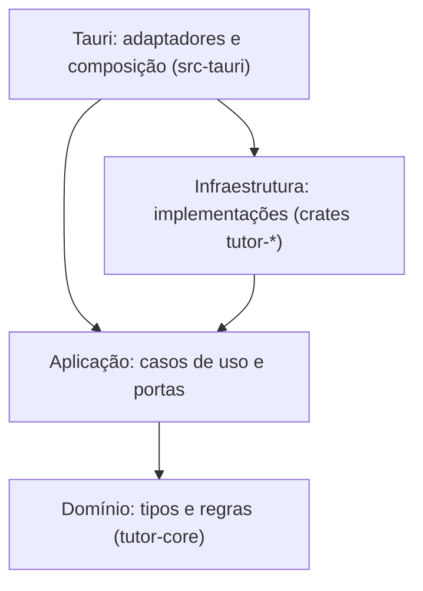

# DXTUTOR IDE — arquitectura

Documento vivo. Descreve o **estado actual** (base `main`,
`6017c120e15b4155a803c74eac86e39590f5c10a`; a secção da UI foi actualizada no fecho da U7 do ADR-0004,
2026-11-25) e a **arquitectura de destino** da reorganização Clean Architecture. O que ainda não existe está marcado como
*destino*.

## 1. Visão geral

O DXTUTOR IDE é uma aplicação desktop Tauri 2 com:

- um «cérebro» em Rust organizado em crates `tutor-*` (workspace Cargo);
- uma casca desktop `src-tauri` que expõe comandos IPC e compõe a aplicação;
- uma UI web em TypeScript + Vite em `ui-app/` (a única UI oficial — ver
  ADR-0001), embutida em tempo de compilação via `frontendDist`.

Entradas alternativas sobre o mesmo cérebro: `tutor-cli` e `tutor-tui`.

## 2. Camadas e regra de dependências (destino)

As setas indicam dependências Rust. O frontend comunica por IPC e **não** faz
parte deste grafo. Regra: as dependências apontam para dentro; o domínio não
conhece mecanismos externos.

| Camada | Responsabilidade | Localização (actual → destino) |
|---|---|---|
| Apresentação web | DOM, componentes, navegação, estado visual | `ui-app/src/` → `ui-app/src/app/`, `features/`, `shared/` |
| Integração frontend | Cliente IPC tipado, subscrições, adaptação de erros | disperso (`bridge.ts`, casts) → `ui-app/src/platform/tauri/`, `contracts/` |
| Adaptadores desktop | Commands, DTOs IPC, eventos, composição | `src-tauri/src/lib.rs` (monólito) → `commands/`, `dto/`, `events/`, `composition.rs` |
| Aplicação | Casos de uso, coordenação, políticas, portas | dentro de `lib.rs`/crates → `crates/tutor-application/` *(se a extracção justificar)* |
| Domínio | Tipos e invariantes de negócio | `crates/tutor-core/` (evoluir) |
| Infraestrutura | Ficheiros, SQLite, HTTP, processos, motores | crates `tutor-eval/llm/track/board` + módulos `src-tauri` como adaptadores |
| Entradas alternativas | CLI e TUI | `crates/tutor-cli/`, `crates/tutor-tui/` (preservar) |

Os nomes de destino são propostas; crates novas só se criam depois de
apresentar árvore e grafo sem ciclos. Não se cria uma crate por tipo/ficheiro.

## 3. Estado actual (resumido)

### Backend (`src-tauri/src/`, bytes)

| Módulo | Bytes | Papel |
|---|---|---|
| `lib.rs` | 101 956 | **Monólito**: DTOs, regras, orquestração, 95 comandos, testes |
| `fsops.rs` | 37 780 | Operações de ficheiros + workspace (10 comandos) |
| `lsp.rs` | 29 074 | LSP (8 comandos) |
| `llm.rs` | 17 709 | HTTP de modelos |
| `debug.rs` | 15 922 | Debug |
| `pair.rs` | 15 294 | PairCode (canal cifrado) |
| `procs.rs` | 8 668 | Processos |
| `workspace.rs` | 7 035 | Resolução de workspace |
| `bridge.rs` | 6 462 | 14 comandos genéricos da v7 |
| `keys.rs` | 5 958 | Segredos |
| `pty.rs` | 5 763 | PTY (4 comandos) |
| `board.rs` | 2 043 | Board (2 comandos) |
| `vsix.rs` | 1 647 | VSIX |
| `main.rs` | 171 | Entrada fina |

### Crates (`crates/`, ficheiros .rs / linhas)

| Crate | Ficheiros | Linhas | Papel |
|---|---|---|---|
| `tutor-eval` | 27 | 12 186 | Avaliação, complexidade, review, CodeMap, LSP, git, arch |
| `tutor-llm` | 3 | 2 040 | Contratos/políticas + HTTP de dica/plano/correcção, chat |
| `tutor-core` | 7 | 1 342 | Domínio + currículo |
| `tutor-tui` | 3 | 820 | Editor TUI |
| `tutor-track` | 2 | 349 | Registo de tentativas (SQLite) |
| `tutor-board` | 1 | 294 | Board kanban (SQLite) |
| `tutor-cli` | 1 | 200 | Prova ponta-a-ponta |
| `tutor-agent` | 7 | — | Harness v2 do Co-Dev: loop de agente com tool use nativo (ADR-0003); provedores Anthropic e OpenAI-compatível (Codex, Gemini, Ollama — F8). Depende de `serde`/`serde_json`/`ureq`/`ignore`/`regex` e de `tutor-llm` (política única da modebar); consumido por `src-tauri` via `codev_agent` |

### UI (`ui-app/src/`, actualizado no fecho da U7 do ADR-0004, 2026-11-25)

- ~400 ficheiros TypeScript, nenhum com `@ts-nocheck`. Um só ponto de entrada (`main.ts`), um só
  `<script>` no `index.html`; a ordem dos imports é a ordem de avaliação (e conta: ver abaixo).
- **Features em camadas** (`features/<nome>/domain|application|ui|infrastructure`, governadas por A7/A8 do
  `arch-check`): codev, ext, codereview, scm, debug, board, visualizer, infra, learn, panel, arch, testing,
  lsp, project, hood, ops, codebase, comments. Ao lado, os **resíduos de composição** `features/<nome>.ts`
  (donos do DOM e do estado de cada feature) e os módulos-folha (tabs, explorer, palette, terminal, …).
- **`app/`**: `store/` (os donos do estado — agente, editor, layout, workspace, config — com eventos no
  `bus`), `actions.ts` (o despachante delegado de `data-action`, primeiro listener do document), `services.ts`
  (o registo tipado para quem avalia antes do módulo que lê), `i18n.ts` (catálogos `en`/`ptAO` por chave),
  `styles.ts` (a cascata dos CSS por dono), `commands.ts`/`boot-steps.ts` (menus, paleta e o arranque).
- **`platform/`**: `tauri/` (os clientes IPC tipados — 0 `invoke` cru fora daqui) e `desktop/` (o que só existe
  na app Tauri, instalado por `bridge.ts`; as features expõem portas em `app/desktop.ts`, que o desktop
  preenche — nada de reatribuir funções no `window`).
- **O `window` (fecho da U7, medida corrigida na U7p):** 291 publicações contando as superfícies `publish({…})` das pontes e as escritas por fachada (a medida antiga, que só via `window.X =` e `Object.assign(window, {…})`, descera de 286 a 130) e 7 shims de estado `ownedGlobal`. Ficam as
  que módulos ou testes de outras sessões ainda lêem, as decoradas em tempo de execução e as chamadas por nome
  (os passos `boot…boot6`/`i18nBoot` do `startup.ts`); o inventário, com quem desbloqueia cada nome, está no
  ADR-0004 («U7 — fecho»). Regras: só os ficheiros da lista A9 do `arch-check` publicam no `window`, e as
  métricas do `ui-metrics.sh` (globais, shims) só descem.
- **Como um módulo lê outro:** por import, se o dono avalia antes; pelo registo `app/services.ts` (chamado no
  acto, nunca ao avaliar) se o dono avalia depois — um import puxaria a avaliação do dono para mais cedo e
  trocaria a ordem dos efeitos. Estado partilhado lê-se no store de `app/store`.

## 4. Contratos IPC

- **150 comandos** registados em `generate_handler!` (`lib.rs:2483`):
  95 em `lib.rs` + 14 `bridge` + 10 `fsops` + 8 `lsp` + 4 `pty` + 2 `board`.
- Convenções a preservar na migração: nomes públicos, camelCase, opcionais,
  nulabilidade, identificadores e eventos. O inventário completo está em
  `MIGRATION.md §2`; a **matriz detalhada** (args/retorno/erro/evento/
  consumidor-UI/política dos 150 comandos) em `IPC-MATRIX.md`, verificada por
  `scripts/arch-check.sh`.
- **Destino:** cliente IPC tipado em `ui-app/src/platform/tauri/`; as views
  consomem operações (`workspace.open`, `board.save`, `terminal.start`) em vez
  de espalhar strings de comando e casts.

## 5. Inicialização (destino)

- Backend: `composition.rs` monta dependências (implementações concretas) e
  injecta contratos nos casos de uso; `lib.rs` limita-se a montar e registar.
- Frontend (*feito* no ADR-0004): o ponto de entrada explícito `ui-app/src/main.ts` existe, os
  `v5.ts`/`v6.ts`/`app.ts` dissolveram-se nas features e o desktop entra por portas (`app/desktop.ts`), não
  por substituições no `window`; os donos do estado vivem em `app/store/`. *Destino* que falta: o arranque
  ainda corre os passos `bootN` publicados no `window` (`startup.ts`), e parte da aplicação ainda se lê pelo
  `window` (ver §3, «O `window`»).

## 6. Segurança (fronteira)

- Políticas de execução do agente (ler/escrever ficheiros, correr ferramentas,
  Git/infra) são autoridade do **backend**, não apenas do JavaScript.
- CSP: `script-src 'self'`, sem `'unsafe-inline'` desde a U5e do ADR-0004 — os handlers inline
  passaram a `data-action` com despachantes delegados (`app/actions.ts` e os das features), e a
  métrica U5 do `ui-metrics.sh` impede que voltem. O `style-src` mantém `'unsafe-inline'` (há
  `style="…"` gerado em muitos sítios; decisão §9.3 do ADR-0004) e, por isso, também
  `dangerousDisableAssetCspModification: true`: se o Tauri injectasse nonces/hashes no `style-src`,
  o browser passaria a ignorar o `'unsafe-inline'`.
- Segredos ficam no backend (`keys.rs`), fora dos contratos de leitura da UI.
- PairCode: ChaCha20-Poly1305 por sessão — não alterar primitivas numa
  reorganização de módulos.
