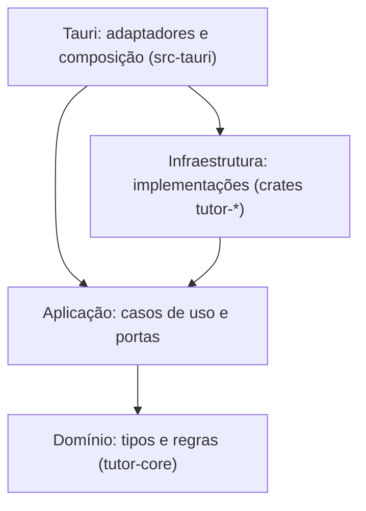

# DXTUTOR IDE — arquitectura

Documento vivo. Descreve o **estado actual** (base `main`,
`6017c120e15b4155a803c74eac86e39590f5c10a`) e a **arquitectura de destino** da
reorganização Clean Architecture. O que ainda não existe está marcado como
*destino*.

## 1. Visão geral

O DXTUTOR IDE é uma aplicação desktop Tauri 2 com:

- um «cérebro» em Rust organizado em crates `tutor-*` (workspace Cargo);
- uma casca desktop `src-tauri` que expõe comandos IPC e compõe a aplicação;
- uma UI web em TypeScript + Vite em `ui-app/` (a única UI oficial — ver
  ADR-0001), embutida em tempo de compilação via `frontendDist`.

Entradas alternativas sobre o mesmo cérebro: `tutor-cli` e `tutor-tui`.

## 2. Camadas e regra de dependências (destino)

As setas indicam dependências Rust. O frontend comunica por IPC e **não** faz
parte deste grafo. Regra: as dependências apontam para dentro; o domínio não
conhece mecanismos externos.

| Camada | Responsabilidade | Localização (actual → destino) |
|---|---|---|
| Apresentação web | DOM, componentes, navegação, estado visual | `ui-app/src/` → `ui-app/src/app/`, `features/`, `shared/` |
| Integração frontend | Cliente IPC tipado, subscrições, adaptação de erros | disperso (`bridge.ts`, casts) → `ui-app/src/platform/tauri/`, `contracts/` |
| Adaptadores desktop | Commands, DTOs IPC, eventos, composição | `src-tauri/src/lib.rs` (monólito) → `commands/`, `dto/`, `events/`, `composition.rs` |
| Aplicação | Casos de uso, coordenação, políticas, portas | dentro de `lib.rs`/crates → `crates/tutor-application/` *(se a extracção justificar)* |
| Domínio | Tipos e invariantes de negócio | `crates/tutor-core/` (evoluir) |
| Infraestrutura | Ficheiros, SQLite, HTTP, processos, motores | crates `tutor-eval/llm/track/board` + módulos `src-tauri` como adaptadores |
| Entradas alternativas | CLI e TUI | `crates/tutor-cli/`, `crates/tutor-tui/` (preservar) |

Os nomes de destino são propostas; crates novas só se criam depois de
apresentar árvore e grafo sem ciclos. Não se cria uma crate por tipo/ficheiro.

## 3. Estado actual (resumido)

### Backend (`src-tauri/src/`, bytes)

| Módulo | Bytes | Papel |
|---|---|---|
| `lib.rs` | 101 956 | **Monólito**: DTOs, regras, orquestração, 95 comandos, testes |
| `fsops.rs` | 37 780 | Operações de ficheiros + workspace (10 comandos) |
| `lsp.rs` | 29 074 | LSP (8 comandos) |
| `llm.rs` | 17 709 | HTTP de modelos |
| `debug.rs` | 15 922 | Debug |
| `pair.rs` | 15 294 | PairCode (canal cifrado) |
| `procs.rs` | 8 668 | Processos |
| `workspace.rs` | 7 035 | Resolução de workspace |
| `bridge.rs` | 6 462 | 14 comandos genéricos da v7 |
| `keys.rs` | 5 958 | Segredos |
| `pty.rs` | 5 763 | PTY (4 comandos) |
| `board.rs` | 2 043 | Board (2 comandos) |
| `vsix.rs` | 1 647 | VSIX |
| `main.rs` | 171 | Entrada fina |

### Crates (`crates/`, ficheiros .rs / linhas)

| Crate | Ficheiros | Linhas | Papel |
|---|---|---|---|
| `tutor-eval` | 27 | 12 186 | Avaliação, complexidade, review, CodeMap, LSP, git, arch |
| `tutor-llm` | 3 | 2 040 | Contratos/políticas + HTTP de dica/plano/correcção, chat |
| `tutor-core` | 7 | 1 342 | Domínio + currículo |
| `tutor-tui` | 3 | 820 | Editor TUI |
| `tutor-track` | 2 | 349 | Registo de tentativas (SQLite) |
| `tutor-board` | 1 | 294 | Board kanban (SQLite) |
| `tutor-cli` | 1 | 200 | Prova ponta-a-ponta |

### UI (`ui-app/src/`)

- 39 ficheiros TypeScript; 31 em `features/`.
- Arranque por encadeamento: `startup.ts` chama
  `boot();boot3();boot4();boot5();boot6();boot7();i18nBoot();`.
- `core.ts` funciona em parte como fachada sobre `window`; muitas features
  publicam globais (`boot.ts` com 63 publicações `window.X=`, `codev.ts` 19,
  `palette.ts`/`debug.ts` 12 …).
- `bridge.ts` substitui funções em tempo de execução (execução, Git, infra,
  missões), ligando a UI ao backend real.
- 21 ficheiros com `@ts-nocheck` (ver MIGRATION.md).

## 4. Contratos IPC

- **133 comandos** registados em `generate_handler!` (`lib.rs:2483`):
  95 em `lib.rs` + 14 `bridge` + 10 `fsops` + 8 `lsp` + 4 `pty` + 2 `board`.
- Convenções a preservar na migração: nomes públicos, camelCase, opcionais,
  nulabilidade, identificadores e eventos. O inventário completo está em
  `MIGRATION.md`.
- **Destino:** cliente IPC tipado em `ui-app/src/platform/tauri/`; as views
  consomem operações (`workspace.open`, `board.save`, `terminal.start`) em vez
  de espalhar strings de comando e casts.

## 5. Inicialização (destino)

- Backend: `composition.rs` monta dependências (implementações concretas) e
  injecta contratos nos casos de uso; `lib.rs` limita-se a montar e registar.
- Frontend: um ponto de entrada explícito (`ui-app/src/main.ts`) compõe estado
  e serviços, regista funcionalidades e arranca uma vez — substituindo o
  encadeamento `bootN` e as substituições de `v5.ts`/`v6.ts`/`bridge.ts`.
- Proprietários de estado definidos por domínio (workspace, editor,
  aprendizagem, agente, Git, terminal, colaboração), sem um objecto global que
  exponha toda a aplicação.

## 6. Segurança (fronteira)

- Políticas de execução do agente (ler/escrever ficheiros, correr ferramentas,
  Git/infra) são autoridade do **backend**, não apenas do JavaScript.
- CSP actual inclui `script-src 'unsafe-inline'` e
  `dangerousDisableAssetCspModification: true` por causa dos handlers inline.
  Destino: migrar handlers inline antes de retirar essas permissões.
- Segredos ficam no backend (`keys.rs`), fora dos contratos de leitura da UI.
- PairCode: ChaCha20-Poly1305 por sessão — não alterar primitivas numa
  reorganização de módulos.
